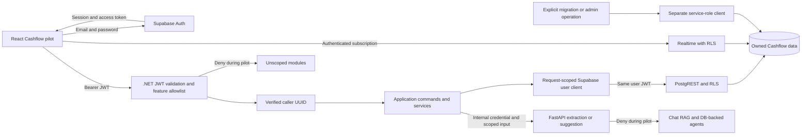
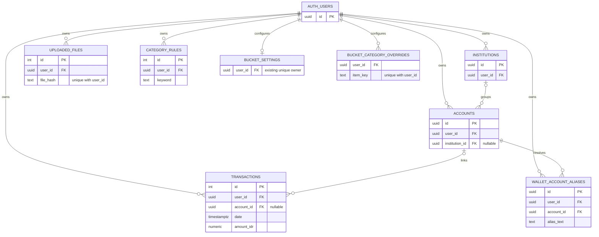

# PF-S08 — Supabase Auth Foundation + Cashflow Ownership

> **Status:** Done (2026-10-16, accepted by the owner). Was: Ready to review (2026-10-15; owner smoke test: [steps](../ready-to-review/owner-smoke-test-PF-S08-PF-141.md), which stays with PF-141 until that plan closes). Before that: In Progress — pilot live on the local main stack since 2026-10-14 (merged to main, flags on). Open: follow-ups listed in the 2026-10-14 rollout record; remote issues #71/#72 not yet reviewed.
> **Created:** 2026-10-09 (Asia/Makassar)
> **Revised:** 2026-10-14 — populated-upgrade rehearsal on a restored copy of main's database, dedup parity matrix (one collation fix), fault/race, event-path and token-expiry checks passed; rollout remains pending
> **Task:** PF-S08 — backend auth foundation and Cashflow ownership
> **Related work:** PF-S09 frontend auth; coordinated in this shared plan, no new ticket allocated
> **Remote status:** Existing issues #71/#72 are references only; not verified or changed by this planning task
> **Supersedes:** Auth direction of [PF-107 Phase 5](../cancelled/PF-107-phase-5-auth-and-tax-todo.md). Goals/tax/full Assets isolation remain deferred, not completed.
> **Depends on:** Existing Supabase schema/SDK and synchronous Cashflow import. No dependency on PF-107 Phase 2–4.
> **Implementation gate:** Verified database access and explicit legacy-owner mapping before applying migrations to a populated environment

## Objective and user outcome

Pengguna login, mengimpor transaksi, dan hanya melihat atau mengelola Cashflow miliknya sendiri. User A dan B dapat mengimpor file identik tanpa saling dianggap duplikat; saldo, kategori pribadi, export, dan reset tetap terpisah.

Identitas kanonis adalah UUID `auth.users.id` dari JWT Supabase yang diverifikasi. `user_id` ditentukan server, bukan input browser, hasil parser, atau penilaian LLM. Tidak perlu tabel password atau identity provider baru. Profile/display name bisa ditambahkan kemudian.

Fondasi ini dapat dipakai ulang oleh modul lain. Release pertama adalah pilot Cashflow untuk pengguna yang diprovisikan sebelumnya, dengan email/password, tanpa public signup UI. Nonaktifkan signup langsung di Auth untuk environment pilot; membuat akun test lokal adalah tindakan terpisah dalam harness.

## Current evidence and why the old plan is replaced

Source diperiksa pada 2026-10-08/09; bukti adalah kode/migration, bukan bukti DB sudah menerapkannya.

| Evidence | Consequence |
|---|---|
| [Program.cs](../../apps/api/src/PersonalFinance.Api/Program.cs) belum mendaftarkan JWT authentication | Backend auth merupakan pekerjaan baru, bukan retrofit ke middleware yang sudah ada |
| [Supabase DI](../../apps/api/src/PersonalFinance.Infrastructure/Supabase/DependencyInjection.cs) memakai singleton service-role client | RLS flip saja tidak mengisolasi request API |
| [Transaction.cs](../../apps/api/src/PersonalFinance.Domain/Entities/Transaction.cs) tidak punya user_id; account_id nullable | Transaksi membutuhkan owner langsung, termasuk sebelum rekening dikenali |
| [Nullable account migration](../../supabase/migrations/20260519000001_transactions_account_id_nullable.sql) dan [file hash schema](../../supabase/migrations/20260504111800_deduplication_upgrades.sql) memakai dedup global | Uniqueness dan pencarian duplikat harus per pengguna |
| [Balance view](../../supabase/migrations/20260519000003_fix_balance_view_global.sql) memakai window global | Running balance perlu partition per user, tetap lintas rekening pengguna yang sama |
| [Reset handler](../../apps/api/src/PersonalFinance.Application/Commands/DeleteAllTransactionsCommandHandler.cs) menghapus seluruh transaksi/file hashes | Reset harus hanya data caller |
| [TransactionsController](../../apps/api/src/PersonalFinance.Api/Controllers/TransactionsController.cs) mengakses accounts/aliases, experimental storage, dan background embeddings | Audit semua jalan masuk/keluar; tidak cukup mengubah CreateTransactionCommand |
| [BucketsService](../../apps/api/src/PersonalFinance.Application/Services/Buckets/BucketsService.cs) memakai Guid.Empty | Buckets termasuk dependency Cashflow, bukan otomatis aman setelah transaksi diberi owner |
| [chatApi.ts](../../apps/frontend/src/api/chatApi.ts) langsung ke FastAPI; [aggregator](../../services/ai-service/app/services/aggregator.py) memakai SQL tanpa owner | Chat/RAG dibatasi server selama pilot; tidak menyatakan seluruh app multi-user safe |

Plan lama menggabungkan auth, Goals, dan laporan pajak dengan dependensi Phase 4 yang tidak dibutuhkan auth. SQL lamanya juga menganggap cache FX/harga memiliki user_id; jobs dan tabel snapshot yang dirujuk belum tersedia. Konten lamanya disimpan sebagai sejarah, bukan instruksi eksekusi.

## Scope and feature boundary

### Included in the pilot

- Login/logout, session restore/refresh, protected routes, caller identity pada API.
- Synchronous upload-preview → review → submit, termasuk CSV/PDF/image extraction yang sudah ada.
- Transactions list/detail/filter/pagination, counts, Cashflow statement, export, reset, balances, account summaries, spending analysis, deterministic insights/daily pulse, dan Buckets.
- Institutions/accounts CRUD yang diperlukan Cashflow; owner untuk relasi, aliases, uploaded file hashes, personal category rules, bucket settings/overrides.
- Shared category presets tetap read-only; salin defaults menjadi rules pribadi secara sengaja. Tidak membagikan custom rules pengguna.
- RLS/grants, safe balance view, migration/backfill checks, query-cache/realtime isolation, dan harness pengujian dua pengguna.

### Deferred features and required access restrictions

- Goals, tax/disposal ledger, Holdings/valuations/liabilities/net-worth, Investment, Desk, Journey scoring/advisor, Macro Lab, durable webhook import, public signup, OAuth/MFA, roles/household sharing.
- Private Cashflow hanya dapat dibuka pada route yang tercantum dalam allowlist release. Default landing setelah login menjadi `/cashflow/overview`, menggantikan ketergantungan landing `/journey` selama pilot.
- API endpoint modul yang belum diisolasi ditolak walau caller login. Hiding sidebar saja bukan batas akses.
- Semua tabel/view/RPC di schema exposed diinventaris. Cabut akses `anon`/`authenticated` ke data personal yang belum diisolasi, termasuk embedding search_text, Journey/Investment/Desk/Macro tables. Periksa exposed GraphQL dan fungsi SQL juga.
- Shared FX/price caches: jika diperlukan, read-only sesuai kebutuhan; write hanya administratif. Jangan menambah ownership palsu pada data pasar bersama.
- FastAPI `/ask`, `/ask/stream`, `/ask/followups`, `/search`, `/embed-transactions`, `/advisor`, `/journey/advise`, `/portfolio-review`, `/categorize-agent` ditolak pada pilot; hentikan embedding dispatch dari submit. Jangan hanya menghapus UI chat.
- Extraction dan suggestion yang diperlukan upload dipanggil internal oleh .NET dengan credential service-to-service, tanpa akses DB pengguna global. Audit `/categorize`, startup `_load_rules`/`_load_categories`, history/tools/cache: nonaktifkan jalur yang memakai corpus global; pakai konteks scoped dari .NET atau defaults publik yang tetap. Jangan membuat gate yang malah mematikan upload standar.
- `upload-preview-new` ditolak selama pilot karena pipeline asynchronous-nya belum lengkap. Storage objek existing tidak boleh tetap terbuka kepada client lain; jangan memindahkan atau menghapus file lama tanpa pemetaan owner.
- Journey recalc events tidak memakai placeholder atau mengakses data global saat pilot; hentikan consumer tersebut secara eksplisit sampai follow-up tersedia.

## Approach comparison

Skor 1–5, makin tinggi makin sesuai. Penilaian arsitektur, bukan pengukuran performa.

| Approach | User value | Scope fit | Integration fit | Testability | Governance | Total |
|---|---:|---:|---:|---:|---:|---:|
| Login/identity saja; ownership ditunda | 2 | 5 | 3 | 3 | 2 | 15 |
| **Auth + isolasi Cashflow + deny unscoped features** | **5** | **4** | **4** | **5** | **5** | **23** |
| Semua modul + AI diisolasi sekaligus | 5 | 1 | 3 | 3 | 4 | 16 |

Pilih pendekatan kedua: menghasilkan alur pengguna lengkap dan ownership yang bisa diverifikasi tanpa memasukkan seluruh backlog Assets/AI. Restriksi sementara merupakan bagian scope yang harus dijelaskan pada UI dan release notes. Membuka kembali fitur membutuhkan follow-up ownership, bukan sekadar mengganti feature flag.

## Visual 1 — Architecture and trust boundary (proposed)



User client wajib request-scoped; jangan mengubah session/Authorization pada singleton bersama. Client administratif tidak dapat menjadi silent fallback jika token tidak ada. Reuse Supabase C# SDK 1.1.1 bila kemampuan token per-request terbukti; lakukan spike lebih dulu, tanpa mengasumsikan API JS tersedia di C#.

## Visual 2 — Login, read and logout sequence (proposed)

```mermaid
sequenceDiagram
    actor User
    participant UI as React
    participant Auth as Supabase Auth
    participant API as .NET API
    participant DB as PostgREST and RLS
    User->>UI: Login
    UI->>Auth: Email and password
    Auth-->>UI: Session plus access token
    UI->>API: GET transactions with Bearer JWT
    API->>API: Verify signature, issuer, audience, expiry and UUID subject
    alt Token invalid or absent
        API-->>UI: 401, no database call
    else Valid user and allowed feature
        API->>DB: User-scoped query with same JWT
        DB->>DB: RLS restricts owner; view partitions by owner
        DB-->>API: Caller rows and count only
        API-->>UI: Paginated result
    end
    User->>UI: Logout or switch account
    UI->>UI: Cancel requests, clear queries, previews and subscriptions
    UI->>Auth: Sign out or establish next session
    Note over UI,API: Late responses from the prior identity must not populate new state
```

## Visual 3 — ERD for owned data (target, not current schema)



RLS pada child saja tidak menjamin parent punya owner yang sama. Untuk links transaksi→account, account→institution, alias→account, gunakan unique parent `(user_id,id)` dan composite FK `(user_id,parent_id)` sesudah preflight. Nullable parent tetap didukung. Existing FK/delete semantics dipertahankan atau diubah eksplisit; test SET NULL jangan sampai mengosongkan user_id. UUID/int ID existing tidak diubah. Tabel Auth dikelola Supabase; diagram tidak meminta membuat `public.users`.

## Visual 4 — Import and ownership sequence (proposed)

```mermaid
sequenceDiagram
    participant UI as Upload review
    participant API as Authenticated API
    participant App as Scoped import service
    participant Parser as Parser or internal extractor
    participant DB as User client and database
    UI->>API: Preview file with JWT
    API->>App: Caller UUID plus file
    App->>DB: Check file hash for caller only
    App->>Parser: Parse content without owner inference
    Parser-->>App: Transactions and account names
    App->>DB: Resolve caller accounts, aliases and duplicates
    App-->>UI: Preview with owner-scoped matches
    UI->>API: Submit reviewed rows with JWT
    API->>App: Caller UUID plus rows
    App->>App: Set owner server-side; validate account ownership
    App->>DB: Atomic submit RPC with request_id and reviewed payload
    DB->>DB: Lock caller, check receipt, recheck duplicates and parent ownership
    DB->>DB: Commit rows, hash, aliases, rules and receipt together
    DB-->>App: Committed result or replay of original receipt
    App-->>UI: Imported result with inserted and duplicate counts
    Note over App,DB: Preview is advisory; submit is authoritative and retry uses the same request_id
```

Tidak memperluas task menjadi durable import/queue. Submit memakai satu transaksi database dan receipt untuk retry; tidak ada status pekerjaan asynchronous. Exact unique index adalah pertahanan tambahan, sedangkan predicate duplicate yang kompatibel dijalankan di bawah lock owner. Tidak ada file hash sukses tanpa commit transaksi/receipt.

## Acceptance criteria

- [x] Pilot accounts dapat login/logout dan restore/refresh session; loading/error states, keyboard, mobile, light/dark mengikuti Zen. — `auth-cashflow.spec.ts` covers login, reload, logout, switch, keyboard, mobile and theme; `auth-session-expiry.spec.ts` (via `scripts/pf_s08_session_expiry.py`, harness `jwt_expiry = 20`) proves the expired token is rejected by the API, the app refreshes and keeps loading, and reload restores the session through the rotated refresh token.
- [x] API menolak token hilang/invalid/expired/wrong issuer/wrong audience dan subject non-UUID; owner selalu berasal dari verified caller.
- [x] User client terpisah per request; request A/B bersamaan tidak saling membawa token atau hasil.
- [x] Semua transaksi baru punya owner termasuk account_id null; account/institution/alias lintas owner ditolak server dan DB.
- [x] Semua Cashflow reads, counts, balances, exports, insights, Spending dan Buckets hanya memakai data caller.
- [x] Duplicate file/transaction hanya berlaku pada owner yang sama; A/B dapat mengimpor file identik.
- [x] Preview dan submit memakai predicate duplicate yang sama; submit melakukan recheck setelah lock. Concurrent same-owner imports tidak menggandakan transaksi, termasuk normalized description dan NULL statement_balance. — Shared 22-case matrix `supabase/tests/fixtures/pf-s08-dedup-parity.json` runs against the C# tagger (`DedupParityTests`) and the real RPC (`scripts/pf_s08_dedup_parity.py`). It found one divergence: ICU `lower()` applies context rules (word-final capital sigma, dotted capital I) that .NET does not. Fixed by `20261014000000_pf_s08_dedup_simple_case_fold.sql` (`COLLATE pg_c_utf8`) plus an explicit U+0130 fold in C#; both halves now pass all 22.
- [x] Submit atomically commits rows, file hash, aliases, submit-induced rules dan receipt. Fault sebelum commit meninggalkan nol efek; response hilang sesudah commit dapat direplay dengan request_id/payload yang sama tanpa insert ulang. Changed payload dengan request_id yang sama menghasilkan 409. — `pf-s08-import-faults.sql` now also injects a fault right after a row insert; `scripts/pf_s08_reset_race.py` proves submit→reset and reset→submit serialize on the owner lock and that a waiter past the 3 s `lock_timeout` fails with no effect.
- [x] Custom category rules, aliases, file hashes dan bucket preferences tidak dibagikan; shared presets read-only.
- [x] Reset A hanya menghapus transaksi, file-hash metadata dan derived transaction embeddings A; data B serta rekening/preferences tetap utuh.
- [x] Balance view memakai window per owner dan invoker-safe access; tidak membocorkan saldo/count melalui query langsung.
- [x] Logout/account switch menghapus query cache, preview, selection, chat state dan realtime subscription; late responses tidak mengisi state baru. — `AuthProvider` cancels queries, swaps the QueryClient and remounts the tree keyed by user id; Realtime channel is per user with `user_id` filter; only date-format prefs live in localStorage. Playwright verifies switch, late A response after B and Realtime A-positive/B-negative.
- [x] Direct PostgREST/GraphQL/view/RPC/storage access ke data personal yang belum diisolasi ditolak untuk anon dan authenticated.
- [x] Unscoped .NET/FastAPI routes, experimental upload, embedding dispatch dan Journey placeholder consumers dinonaktifkan server-side; standard extraction tetap berfungsi dengan mocks. — Embedding dispatch has no caller after PF-S08; both Journey recalc handlers now no-op when `ICashflowPilotMode.Enabled` (`JourneyRecalcPilotGateTests`). Mocked `/parse-pdf` and new `/parse-image` tests pass under the gate with the internal key, and `/parse-image` without the key never reaches the parser.
- [x] Legacy data dipetakan eksplisit, dipreservasi, dan tervalidasi; tidak ada auto-claim kepada pengguna pertama atau destructive reset.
  - ✅ **Applied 2026-10-14:** all legacy rows mapped to one new Auth user (the owner's email) with `supabase/scripts/pf-s08-map-single-owner.sql`, after a rehearsal on a restored copy. Backups kept outside the repo; see the rollout record.
- [x] Fresh install mengikuti staged bootstrap sampai expand → provision/map fixtures → enforce → user-rule bootstrap; populated upgrade mengikuti backup/maintenance → expand → explicit mapping → enforce. Keduanya preserve counts/relations dan tidak menjalankan seed personal tanpa owner valid. — Fresh path proven 2026-10-10; populated path rehearsed 2026-10-14 on a verified restore of main's database (checkpoint below).
- [x] Real local Supabase + API tests membuktikan allow/deny dua pengguna; skipped tests tidak dianggap coverage.

## Data and contract decisions

1. Tambah owner pada transactions, uploaded_files, category_rules, aliases; accounts/institutions/bucket tables sudah punya user_id, verifikasi FK/policies aktual. User FK baru tidak otomatis berarti account deletion feature.
2. Index pencarian mengikuti `(user_id,date,id)` atau workload aktual; file uniqueness menjadi `(user_id,file_hash)`. Exact transaction index ditambah user_id tanpa menghapus rows existing. Predicate authoritative dan atomic retry dijelaskan di bawah; exact index tidak dianggap setara dengan matcher aplikasi.
3. Alias resolution memakai owner + normalized alias text. Jangan memilih rekening user lain meski nama sama. Pertahankan kemampuan explicit account selection bila nama ambigu dalam satu owner.
4. Public request DTO tidak menerima owner yang bisa dipercaya. Identity adapter di API → Application caller context, sementara domain events membawa owner eksplisit. Handler tidak membaca HttpContext langsung. Untuk pekerjaan non-HTTP, wajib owner eksplisit atau admin capability.
5. Map semua produsen transaksi: single command, bulk submit, pipeline experimental, categorization history, reset, export. Extraction contract `account_name` tetap; tidak memasukkan user_id ke output LLM.
6. Semua hitungan uang tetap decimal dan semantik DB/CR/date existing dipreservasi. Running balance global berarti lintas rekening satu user, bukan lintas seluruh pengguna.

### Finding 1 resolution — authoritative deduplication and atomic retry

**Decision:** preserve existing application duplicate behavior, execute it authoritatively in a synchronous database submit function, and serialize mutations per owner. Do not silently replace fuzzy/NULL matching with exact-index equality.

- Base key: verified owner, date normalized using the existing application timezone semantics and formatted to seconds, amount rounded to two decimals with explicit midpoint-to-even behavior, description trimmed/lowercased with whitespace collapsed, nullable account_id and flow. Store original dates, descriptions and amounts unchanged. SQL/C# parity fixtures must cover Unicode whitespace/case, midpoint rounding and timezone boundaries; use persisted server-derived canonical keys where native SQL normalization differs.
- Balance predicate: equal base key is duplicate when either statement_balance is NULL, or when both are present and absolute difference is strictly less than 0.01. NULL is a wildcard here, not the SQL index's sentinel. Difference exactly 0.01 is not a match. Within a batch, evaluate input order against existing rows and previously accepted rows, as current TagDuplicatesLogic does. This predicate is not transitive; do not encode it as a single unique fingerprint. Owner is always part of the lookup.
- Preview uses the same canonical key/predicate contract but remains advisory. Submit resolves/validates caller accounts, then rechecks against committed rows inside the database transaction. Match all relevant rows; no max_rows truncation. Keep owner-aware exact uniqueness as a second guard. Existing normalized duplicates are reported by preflight and preserved, not automatically consolidated/deleted.
- Add proposed cashflow_import_receipts: owner FK, request_id UUID, server-computed payload_digest, nullable file_hash, committed result with inserted IDs/counts and duplicate count, created_at. Unique (user_id,request_id) and partial unique (user_id,file_hash) when hash exists; RLS limits reads to owner. uploaded_files retains unique (user_id,file_hash). Legacy hashes need no invented receipts. Reset removes caller receipts along with caller transactions/hashes so deliberate reimport remains possible. Clear retained browser submit request_id/result state after reset; a later deliberate import creates a new request_id.
- Submit DTO requires a browser-generated request_id, retained across explicit retries of the same reviewed submission. Digest covers validated submitted rows in order, explicit account choices/names, file hash and filename; exclude derived duplicate flags and preview balances. Specify deterministic decimal/date encoding and digest version. Compute from validated input before mutable alias/default-rule resolution; never trust a supplied digest. Editing the reviewed submission creates a new request_id.
- Proposed submit_cashflow_import RPC acquires a transaction-level advisory lock derived from auth.uid() in a dedicated Cashflow namespace, before reading receipts/hashes/duplicates. Use READ COMMITTED and separate reads after lock acquisition so a waiting caller sees the prior commit. All enabled transaction writers, updates, deletes and reset use the same owner lock and checked RPC boundary; account/institution mutations that change/delete referenced parents also participate. Read-only preview does not lock. No process-local mutex or session-level lock; bound wait and statement timeouts.
- Revoke direct INSERT/UPDATE/DELETE on transactions, uploaded_files, receipts and the related account/institution/alias/private-rule mutation paths from anon/authenticated, including GraphQL mutation paths. Route those enabled writes through checked functions so parent changes and submit-side metadata cannot bypass locking/validation. Use narrowly scoped SECURITY DEFINER mutation functions because callers lack table DML grants: derive owner from verified auth.uid(), reject missing/invalid caller, qualify every row/parent check by owner, validate complete inputs inside the function, fix search_path, schema-qualify objects, prohibit dynamic SQL, revoke PUBLIC/anon EXECUTE, and grant only approved entry points to authenticated. Prefer a dedicated non-login function-owner role with minimum privileges, no BYPASSRLS and no table ownership; test actual RLS/grants under that role. API calls these functions with the caller JWT, never service-role fallback. Direct RPC calls must satisfy the same validation as .NET.
- Inside one transaction: lock → check receipt/hash → validate parents and dedup → insert accepted rows → register file hash → persist aliases and submit-induced private rules → persist result receipt → commit. Remove pre-insert rule writes and separate post-insert hash/alias writes from TransactionsController. No LLM calls under the lock. Required scoped events run only after confirmed commit; replay does not repeat mutations or event dispatch.

| Trigger | Required result |
|---|---|
| New request with accepted rows | 200 only after commit; inserted IDs/count and duplicate count reflect actual rows |
| New request with all rows already matching | 200 with zero inserted and accurate duplicate count; atomically record receipt/hash as a completed no-op |
| Same owner/request_id and identical payload | 200 replay of original committed result, including original IDs; no new writes |
| Same owner/request_id with changed payload | 409 idempotency_conflict; no writes |
| Same owner/file hash under another request_id | Same digest with an existing receipt: replay; different digest or legacy hash without a receipt: 409 file_already_processed; no writes |
| A/B submit identical file | Separate owner locks, hashes, receipts and rows; neither request suppresses the other |
| Failure before commit, including exact uniqueness violation | Roll back all submit effects; never swallow 23505 as an empty successful import. Unexpected constraint conflict is a sanitized 409 requiring review |
| Commit succeeds but HTTP response is lost | Explicit retry with the same request_id/payload reads committed receipt; no second insertion |
| Lock timeout/deadlock or transient DB failure | Sanitized retryable failure, no success claim; explicit retry retains request_id. Do not blindly auto-replay POST |

Verification includes normalized case/whitespace, missing/present balances, 0.009/0.01 differences, NULL account, rounding/date parity, non-transitive three-row cases, existing normalized duplicates, overlapping same-owner batches, simultaneous A/B, changed payload, legacy hashes, direct DML/RPC bypass attempts, reset racing submit, and injected failures after row insertion/before hash, after hash/before receipt, and after commit/before response. Assert rows/hashes/aliases/rules/receipts together, not merely HTTP status.

### Finding 2 resolution — staged bootstrap and populated upgrade

**Decision:** preserve historical migrations and records. Ownership enforcement is a separate migration stage applied only after explicit provisioning/mapping. A one-shot migration-through-latest followed by today's seed.sql is not the supported bootstrap path.

**Fresh database (new empty target, disposable harness first):**

1. Prepare a checked bootstrap script that starts required Supabase services with automatic migration-through-enforce and personal seeding disabled. Verify supported CLI/version targeting before choosing exact commands; apply unchanged historical migrations plus the new expand stage only. Record migration ledger correctly through supported tooling. Do not reset/recreate an existing target to imitate this path.
2. Historical seed migrations still produce placeholder-owned fixtures. Record their generated IDs/counts and relationships in this newly created target. Provision a dedicated fixture Auth user through the admin Auth API with an environment-generated UUID, blocked sign-in and no usable distributed credentials. Map the historical fixture graph to that user before enforcing in-scope FKs. Include dependent deferred-module rows in the mapping report to preserve parent consistency; this does not enable their APIs/grants. Never create a fixed placeholder Auth user or map fixtures to the first pilot login.
3. Replace supabase/seed.sql's ownerless private category-rule inserts with shared preset-only idempotent seeding. Provision A/B test users separately through the harness; bootstrap each user's private rules from shared presets through the scoped application boundary after enforcement. No fixed personal rule IDs, global custom-rule copy, production UUID or credentials in migration/seed files. Inspect setup/start scripts and config so they cannot run the old seed after enforcement.
4. Preflight: every in-scope owner references a real Auth user; no NULL/zero/placeholder owner remains; parent/child owners agree; exact owner-aware indexes can be built. Preserve baseline row counts and original values, with a separate ownership-change report. Verify fixture user cannot obtain a session and no pilot user can read its data.
5. Deploy the checked client/function/gate code while traffic remains denied, apply enforce, then run seed replay and per-user bootstrap twice to prove idempotency. Run real A/B isolation, atomic import and reset tests. Only then allow provisioned pilot traffic.

**Populated database (independently authorized environment operation):**

1. Verify backup and restore procedure, record applied migration ledger/counts, enter maintenance and stop imports/background writers/old clients. Apply only pending expand migrations; never replay historical seed migrations or seed.sql against real data.
2. Provision/verify intended Auth owners. Supply an explicit mapping of existing row IDs/legacy groups to those UUIDs. Placeholder UUID alone is not proof of dummy data in a populated target. Map transactions without accounts, hashes, rules, aliases, accounts/institutions and bucket preferences; account for deferred children before modifying parent owners. Preserve all records and monetary/date fields; ambiguous ownership blocks enforcement.
3. Execute environment-specific backfill with recorded counts and parent consistency checks. Classify any existing hashes lacking receipts as legacy processed files; do not fabricate successful import results. Detect normalized dedup collisions for review without deleting/consolidating transactions. Require zero unmapped in-scope rows and no Auth/parent FK conflicts before proceeding.
4. Deploy gated backend/frontend/functions, apply enforce and verify grants/policies/sequence privileges. Run A/B smoke checks plus count/value invariants, then permit pilot traffic. Do not open a permissive-policy interval or serve old ownership-free code after backfill.

Deliver scripts/runbook and separate fresh/populated integration scenarios. If CLI startup cannot stop before enforce, the bootstrap script must use verified supported staged tooling; lack of a reproducible staged path blocks implementation acceptance. Fixture mapping is restricted to a target demonstrably created empty by that bootstrap. Actual populated/remote application, Auth provisioning and maintenance remain separately authorized operations.

## Affected files (implementation targets, new names proposed)

| Area | Existing paths / proposed additions |
|---|---|
| Auth backend | `apps/api/src/PersonalFinance.Api/Program.cs`, API csproj, proposed `Authentication/` JWT options and caller adapter; placeholder-only config examples |
| Database clients | `apps/api/src/PersonalFinance.Infrastructure/Supabase/DependencyInjection.cs`, SupabaseSettings, proposed user-client factory/admin registration; `StorageService.cs` audited |
| Caller contract | proposed `apps/api/src/PersonalFinance.Application/Interfaces/ICurrentUser.cs`; explicit background/event owner contracts |
| Domain/schema | Transaction, UploadedFile, CategoryRule, WalletAccountAlias, Account, Institution; bucket mappings; proposed import receipt/canonical dedup keys, checked mutation RPCs and grants; new timestamped SQL migrations under `supabase/migrations/` |
| Bootstrap/upgrade | `supabase/seed.sql`, `supabase/config.toml`, existing setup/start scripts after inventory; proposed staged bootstrap, fixture provisioning and mapping preflight scripts/runbook; preserve historical migrations |
| Cashflow API | TransactionsController, AccountsController, CategoryRulesController, SpendingAnalysisController, InsightsController, BucketsController |
| Services/mutations | TransactionService, TransactionPipelineService, CategoryRuleService, CategoryPresetService, DashboardService, SpendingAnalysisService, InsightService, BucketsService; account/institution/transaction commands and validators; Journey event handlers |
| Frontend session | existing `src/lib/supabase.ts`, proposed `src/auth/AuthProvider.tsx`, `RequireAuth.tsx`, `src/pages/auth/LoginPage.tsx`, shared authenticated-fetch helper |
| Frontend wiring | `src/App.tsx`, Sidebar/AppShell, Cashflow/Settings pages, all API clients used by pilot, `useRealtimeTransactions.ts`, upload preview/cache handling, AI-panel gates |
| AI boundary | `services/ai-service/app/main.py`, config and .NET external clients; internal authentication and pilot gates, no new retrieval implementation |
| Tests | API tests + proposed `Integration/CashflowOwnershipTests.cs`, scoped behavior tests, proposed frontend `e2e/auth-cashflow.spec.ts`, mocked AI gate tests |

## Ordered implementation

> **Code audit 2026-10-13:** `[x]` = coded and verified locally; `[~]` = coded, verification incomplete (see the AC notes); `[ ]` = not started. STEP 1 target signing mode/issuer is tracked under STEP 8. Nothing is committed yet (branch `pf-s08-auth-cashflow`).

### [x] STEP 1 — Establish the route/data inventory and token spike

**Purpose:** membatasi blast radius sebelum perubahan DI/migration.

- Enumerate .NET/FastAPI routes, direct browser Supabase access, exposed DB objects and all transaction readers/writers. Record each as scoped, shared read-only, internal, or disabled.
- Verify deployed local DB migration inventory and backup availability; inspect counts/owner anomalies only, without printing financial records/secrets.
- Prove SDK 1.1.1 can create two isolated request clients using user JWTs. Prefer existing SDK; if unsuitable, document the smallest adapter change before implementation.
- Verify actual Supabase JWT signing mode. Configure JwtBearer with signature, issuer, audience, lifetime and subject validation; JWKS only if asymmetric keys are available. Legacy HS256 uses a server-side configured secret, never an unchecked decode. Reject service-role/anon credentials as end-user identity.
- Read root/scoped AGENTS and rules before editing each service. No Claude hooks/settings imported.

**Done when:** inventory and token spike specify exact scopes, including denial for modules outside pilot.

### [x] STEP 2 — Design additive migrations and legacy ownership mapping

**Purpose:** preserve existing data while adding ownership.

- Create timestamped expand and enforce migrations; filenames below are conceptual, generate actual UTC timestamps at execution.
- Expand: nullable owner columns first, supporting indexes; do not edit applied migrations.
- Create a dry-run mapping report: UUID zero, UUID ending 0001, rows without account, and inconsistencies between account/institution/child owners.
- Separate dummy seed records from real personal records. Mapping actual rows to an Auth user is an explicit deployment input, not inferred from email/first login.
- Plan real-data backfill as an environment-specific operation with verified counts. Block enforcement if any in-scope row is unmapped or parent ownership conflicts; do not create a public orphan holding area.
- Enforce: NOT NULL/FK, owner-aware uniqueness, composite relationships, policies with USING and WITH CHECK, exact old policy removal, role grants and safe view. Partition running_balance by user_id; invoker-safe on Postgres 17.
- Deny client grants to unscoped personal tables, embeddings, views/RPCs and storage; account/institution delete paths must not silently cascade into disabled modules. Preserve data by rejecting unsafe deletes.
- Implement both staged paths in Finding 2 resolution, including supported migration targeting/ledger, blocked fixture Auth user, preset-only seed and per-user private-rule bootstrap. Do not invoke automatic through-latest migrations before mapping.
- Add receipt schema and checked mutation RPCs/grants from Finding 1 resolution; audit canonical-key parity and existing normalized collisions before enforcement.

**Done when:** both fresh-schema and populated upgrade scenarios are specified, with ambiguity treated as a blocker rather than auto-claim.

### [x] STEP 3 — Implement backend authentication and scoped database access

**Purpose:** verified identity reaches every approved operation.

- Authentication middleware precedes authorization. Apply authenticated default policy, explicitly permit only health and required public metadata; gate unscoped routes even for authenticated users.
- Provide one caller identity abstraction; fail closed if unavailable. Request-scoped user client carries verified JWT; admin client only reachable from explicit administrative/storage boundaries.
- Move touched direct-controller DB reads into Application services/queries as needed; avoid a repository-wide abstraction rewrite.
- Set owner on writes; qualify mutations by owner + ID and validate parent owner. Foreign resource IDs return generic unavailable/not-found behavior, without disclosing existence.

**Done when:** owner spoofing and missing-token paths cannot reach privileged client behavior; concurrency checks pass.

### [x] STEP 4 — Scope the complete Cashflow workflow

**Purpose:** eliminate secondary leaks beyond the transaction list.

- Scope preview/submit, duplicate identification, account resolution, aliases, hashes, personal rules and histories. Test same-name accounts for A/B and null-account transactions.
- Implement Finding 1 atomic submit/replay contract, shared owner locking across enabled mutations, and database-side validation. Remove catch-23505-as-empty-success and independent hash/alias/rule side effects; direct table DML cannot bypass the checked functions.
- Scope list/detail, counts, view, export, reset, dashboard, account summaries/balances, statement, analysis, deterministic insights/daily pulse, bucket settings/overrides.
- Category presets are immutable shared data; bootstrap private rules for a new user without copying another user's customizations.
- Preserve date filters, opening balance, currency, DB/CR, pagination and financial formulas. Test at least 1001 rows to exceed local PostgREST max_rows=1000.
- Reset deletes caller-owned metadata and derived embeddings without re-enabling AI endpoints. Verify database cascade or an explicit safe internal cleanup path.

**Done when:** all acceptance-listed Cashflow operations pass A/B checks; no placeholder caller remains in pilot paths.

### [x] STEP 5 — Close unscoped service and feature paths

**Purpose:** Cashflow isolation remains true when API URLs are called directly.

- Gate unscoped modules in API and FastAPI, not only UI; protect allowed extraction/suggestion endpoints with internal authentication and deployment reachability.
- Disable background embeddings and Journey recalculation against placeholders. Prevent global AI startup caches/history/tools from supplying cross-user data to allowed import functions.
- Audit shared frontend AI panels, direct storage downloads, Supabase REST/GraphQL and realtime; revoke grants/policies where no safe pilot path exists.
- Service-role operations preserve legitimate internal use but never trust user-supplied user_id or transaction_id without validating ownership.

**Done when:** direct denied-route tests pass with A/B/anon, while mocked CSV/PDF/image standard import still succeeds.

### [x] STEP 6 — Build session UX and authenticated frontend requests

**Purpose:** usable identity lifecycle without stale data after account switch.

- Login form, logout, session loading/restore, guarded routes and default Cashflow landing. Use existing Zen tokens, react-hook-form/Zod and shadcn primitives.
- Reuse Supabase session management; central authenticated fetch sends current token to .NET. Handle refresh and 401 without retry loops or blindly replaying non-idempotent submit/reset calls.
- Include identity in server-state query keys, cancel old requests and clear cache/local preview/form/chat state on identity change. Ignore late responses from prior identity.
- Realtime uses authenticated session/RLS with owner filter as an additional constraint. Resubscribe per user; no global insert toast containing another user's data.
- Restrained UI explains temporarily unavailable modules. Keep public status/health separate from financial data.

**Done when:** browser tests cover refresh/logout/A→B and empty account setup without global seeded records.

### [x] STEP 7 — Build real local isolation tests

**Purpose:** prove policies, API paths and browser state using actual user tokens.

- Provision two disposable Auth users and rows in a test-local Supabase environment; admin credentials only in test setup. Never use service-role tokens for RLS assertions.
- Test API and direct PostgREST/view/GraphQL/RPC/storage allow/deny matrix; validate schema grants, not just endpoint mocks.
- Test JWT invalid/expired/issuer/audience/subject, forged owner, foreign account links, CRUD/list/count/export/reset, dedup, aliases, rules, Buckets, per-owner balances and concurrent A/B calls.
- Run Finding 1 concurrency/parity/fault matrix and Finding 2 fresh-install/seed-replay/populated-upgrade scenarios; fixture sign-in denied, mappings/counts preserved, and no enforcement before valid ownership.
- Test expired session, logout/account switch, realtime payload visibility, and late responses. Mock external paid providers throughout ordinary tests.
- If real harness unavailable, record blocker; do not accept skipped integration cases as an isolation pass.

**Done when:** every release acceptance checkbox has reproducible test evidence.

### [x] STEP 8 — Roll out the pilot and record actual results

**Purpose:** enforce ownership without data loss or access reopening.

- First deploy/verify using the fresh staged bootstrap in Finding 2 resolution. For populated target, follow its separate backup/maintenance/expand/mapped-backfill/gates/enforce sequence; never replay personal seeds. Include atomic-import/replay verification before allowing pilot traffic.
- No writes from old code during backfill/enforcement. No multi-user traffic while policies are permissive or allowlist is incomplete.
- Record applied migration versions, row-count invariants, test results, affected feature restrictions and known limitations directly in this plan and board.
- Keep remote deployment/migration application as separately authorized actions. Plan creation does not deploy, reset, commit or close GitHub issues.

**Done when:** pilot users can use private Cashflow; broader app remains explicitly deferred.

## Verification commands and environments

Commands run individually in PowerShell, with RTK prefix. New test paths below are planned additions, not files that currently exist. Check the actual harness and CLI support before running DB tests.

```powershell
# Repository root — inspect source without actual env files
rtk git status --short
rtk rg -n 'From<Transaction>|From<TransactionWithBalance>|PlaceholderUserId|Guid.Empty' apps/api/src
rtk rg -n 'FROM transactions|FROM transaction_embeddings|asyncpg|@app\.' services/ai-service/app
rtk proxy node .agents/scripts/validate-setup.cjs

# apps/api
rtk proxy dotnet build PersonalFinance.slnx
rtk proxy dotnet test PersonalFinance.slnx
rtk proxy dotnet test PersonalFinance.slnx --filter 'FullyQualifiedName~CashflowOwnershipTests'

# apps/frontend
rtk npm run lint
rtk npm run build
rtk npm run e2e -- e2e/auth-cashflow.spec.ts

# services/ai-service — mocked gate/extraction tests, no paid calls
rtk proxy .venv/Scripts/python.exe -m pytest
```

Use existing Supabase local services only after inspecting configuration. Applying migrations to the test DB is an execution step; applying to a populated/remote DB or resetting any DB requires separate task authorization. No `db reset`, volume pruning, or remote `db push` in the planning task.

## Rollback and data preservation

- Before migration, save verified schema/data backup and mapping counts in the authorized environment, without putting financial records in the repo.
- Prefer a forward fix for policy/client issues. If disabling the pilot, deny app/data access and pause imports; do not restore USING(true) as an availability workaround.
- Retain added owner columns and mappings when rolling back application code. Older code without ownership cannot safely serve multi-user data.
- If data restore is needed, perform it only under explicit authorization and maintenance, preserving newer records deliberately. SQL down scripts alone are not a data recovery strategy.

## Dependencies, estimates and open deployment inputs

- This plan coordinates the foundation portions of PF-S08/S09. It does not claim all historical scope of those issues complete; remote acceptance/closure must be reviewed separately.
- PF-034/037 integration infrastructure is related, but only the harness needed here is required; no broad test-framework overhaul.
- Previous estimate: 5–8 focused developer-days, now provisional pending Step 1. Checked mutation RPCs, receipt/parity tests and staged bootstrap add concrete work; re-estimate after token/RPC/grant and migration-targeting spikes rather than treating the previous range as a commitment.
- Including per-user chat/RAG/Journey would expand this to roughly 8–12 days and a follow-up scope, not this pilot's implicit acceptance.
- Default design selected now: provisioned users, email/password, private Cashflow pilot, deferred modules denied. Deployment input still needed before real-data backfill: exact owner UUID mapping and target environment. These do not block writing/reviewing the plan.

- **Owner decisions 2026-10-15:** legacy asset-side seed rows and Desk fixture trades stay as demo data under the owner. GitHub issues #71/#72 are no longer used; not reviewed, not a closure condition.

## Deferred follow-up register (preserved from old Phase 5)

| Follow-up | Prerequisite / required redesign |
|---|---|
| Savings Goals | Auth foundation; canonical `/goals` decision, backend CRUD and precise runway arithmetic; independent of Phase 4 |
| Disposal ledger + tax support export | Structured sales/lot data, gross proceeds/fees/FX/withheld tax; primary-source rules per instrument/effective date; no notes parsing or automatic compliant claim |
| Assets/Investment/Desk/Macro isolation | Owner-aware services, child relations, jobs and data migrations; user-scoped re-enable criteria |
| Per-user chat/RAG/advisor/Journey | Verified identity across FastAPI/direct SQL/tools/background jobs, owner-scoped retrieval/aggregation/cache/session and real A/B tests |

Tax claims from the archived plan are not accepted as methodology. See [tax reference](../../docs/reference/finance-domain/tax-id.md); its effective dates require correction/verification in the future tax task, not implementation in auth.

## Primary technical references

Reviewed 2026-10-09 for this plan. SDK-specific APIs and deployed signing mode remain Step 1 checks.

- [Supabase Auth](https://supabase.com/docs/guides/auth): managed user identity and sessions.
- [Supabase JWTs](https://supabase.com/docs/guides/auth/jwts): validated subject, signing modes and token forwarding.
- [Supabase RLS](https://supabase.com/docs/guides/database/postgres/row-level-security): service role bypass, policies/grants and invoker-safe views.
- [PostgreSQL transaction-level advisory locks](https://www.postgresql.org/docs/17/explicit-locking.html#ADVISORY-LOCKS): transaction-scoped serialization; the lock is effective only when every enabled writer participates.
- [Supabase database functions](https://supabase.com/docs/guides/database/functions): invoker/definer execution, fixed search_path and explicit EXECUTE grants for checked mutation entry points.
- [Local setup](../../docs/SETUP.md), [current implementation status](../../docs/STATUS.md), [Supabase migration context](../../docs/architecture/supabase-migration.md).

## Planning verification record

- [x] Compared approaches against inspected source and prior audit.
- [x] Added architecture, login sequence, target ERD and import sequence diagrams.
- [x] Preserved old plan history and deferred Goals/tax scope; updated local board only.
- [x] Council findings 1–2 resolved in plan design (2026-10-09): compatible authoritative dedup, atomic submit/receipt/retry and direct-DML closure; explicit fresh/populated migration paths and valid-owner seeding.
- [x] Implementation/runtime isolation checks — disposable real-token PostgREST, GraphQL, Storage, .NET A/B reads/writes, browser login/switch/late-response/Realtime, exposed-grant and two rollback-fault audits, and 1001-row page/export passed. The remaining parity/fault cases and the populated-upgrade rehearsal passed on 2026-10-14 (checkpoint below), and the rollout ran the same day (STEP 8 rollout record).

## Execution checkpoint — 2026-10-09

- Worktree: `.worktrees/pf-s08`, branch `pf-s08-auth-cashflow`. The main checkout's working tree was preserved; this plan and board were copied into the worktree before work began.
- Implemented: JWKS ES256/RS256 JWT validation with explicit legacy HS256 mode, request-scoped user-token Supabase clients, owner-scoped Cashflow reads, frontend login/session and authenticated requests, user-specific query/realtime lifecycle, and FastAPI internal extraction gate. Checked import/reset RPCs, API wiring and frontend request_id/result display are implemented. Unscoped routes remain closed. Both pilot and checked-mutation flags default off.
- SQL applied only to a disposable local harness: owner expand/enforce, guarded historical fixture mapping, checked import/reset with a limited non-login function role, its Auth schema usage fix, and Unicode dedup normalization. Direct table DML stays revoked. Automatic personal seeding and public signup remain disabled; local provisioned email/password login uses [auth.email].enable_signup=true.
- Verified: the prior full API suite passed 364 with 9 skipped; three new focused API tests passed. Frontend production build passed after request_id/result wiring; the prior TypeScript check passed. Earlier AI tests passed 237 with one baseline failure reproduced on the untouched checkout. The local smoke now passes real-token A/B API and PostgREST reads plus checked mutation tests.
- Pending: actual signing mode/issuer in the target; populated owner mapping/backup; checked account, institution, private-rule and bucket mutation RPCs; full canonical/parity/fault matrix and 1001-row reads; complete grants, GraphQL, storage, browser session/realtime and populated upgrade verification; rollout. The default-off flags must remain off until those checks pass. No acceptance criterion is marked complete from partial evidence.
- Local Supabase validation: isolated harness applied expand, mapped 30 historical Desk fixture rows to a blocked Auth user, passed zero-anomaly preflight, then applied enforce and three additive mutation/parity migrations. Rollback-only RLS smoke passed. Real Auth-token A/B PostgREST and live .NET reads, checked import/replay/reset, cross-owner account rejection, rollback of row/alias/rule side effects, per-owner concurrent imports, NULL-account/midpoint/Unicode/0.01 dedup boundaries and direct-DML denial passed. Fixture cleanup completed. No remote or populated database was touched.

## Execution checkpoint — 2026-10-10

- Added checked account/institution setup, update, delete and settings RPCs; private category-rule CRUD/reset; Bucket preference writes and a narrow owner-checked latest-valuation total. The limited non-login function role has explicit grants and owner RLS. Direct client DML stays revoked, and deferred valuation rows remain unreadable through user REST/GraphQL. Added configurable exact browser CORS origins. All new SQL was applied only to the disposable PF-S08 harness.
- Live disposable two-user smoke passes account and institution CRUD, foreign-parent denial, in-use deletion conflict, rules, Bucket preferences and liquid totals, checked import replay/concurrency/rollback/Unicode dedup, reset, read endpoints, GraphQL owner filtering, private Storage object denial, and 1001-row API count/page/CSV export. Concurrent A/B API reads remain isolated; transaction detail returns own row and 404 for the other owner. A/B standard CSV previews match; a checked submitted preview row becomes a duplicate on the next preview. Ordered nontransitive balance matching and an all-duplicate committed no-op pass. The Playwright test passes guarded routing, A/B login, page reload, logout, account switch, a late A response after B has loaded, Realtime A-positive/B-negative insert visibility, keyboard Enter, mobile viewport controls, and theme toggle. Fixture cleanup completes; public signup stays closed.
- Verification: .NET build passed; full .NET tests **369 passed, 9 skipped**. Frontend production build passed. FastAPI pilot-gate tests **3 passed**. Frontend lint still reports **20 errors, 9 warnings**; the app TypeScript check reports **6 errors in unchanged files**, and the same six paths fail on the main checkout. Earlier full AI run had **237 passed, 1 baseline failure** reproduced on the untouched checkout. These existing failures are not treated as PF-S08 coverage.
- Additional database checks: repeatable `supabase/tests/pf-s08-exposed-grants.sql` passed for `public`/`graphql_public` relations/functions and Storage policies; anon has no exposed personal relation reads, authenticated writes require checked RPCs, and vector extension math functions remain callable without personal-data reads. Rollback-only `supabase/tests/pf-s08-import-faults.sql` injected failures before hash and receipt writes and verified zero partial transactions, aliases, rules, hashes, or receipts. Rollback-only `supabase/tests/pf-s08-reset-derived.sql` verified that reset cascades A's embedding and deletes only A's transactions, hashes and receipts while B's data and A/B accounts/preferences remain. Replaying `seed.sql` twice kept 404 shared presets, 12 historical Desk fixture positions, and zero transactions/private rules. The limited function role and legacy policy overlap were corrected in additive migrations.
- Read-only `supabase/scripts/pf-s08-ownership-gate.sql` passed on the disposable mapped harness. It blocks missing/placeholder Auth owners and six direct parent-owner mismatches before enforce. [PF-S08 Cashflow pilot runbook](../../docs/runbooks/pf-s08-cashflow-pilot.md) records the staged local commands and the target backup/mapping/maintenance sequence; no populated-target rehearsal has run.
- Still pending before pilot release: target Auth signing mode/issuer and browser origin, real legacy-owner mapping and backup, remaining canonical preview/submit parity and fault cases, populated-upgrade validation, actual session token expiry/refresh, and deployment. Re-run grants/policies against the actual target before enabling traffic. Both pilot flags remain default off. No populated or remote database, GitHub issue, commit, or deployment was changed.

## Execution checkpoint — 2026-10-14

- Decisions (owner): populated target = the local main Supabase stack; all legacy rows map to one new Auth user with the owner's email; asymmetric JWKS signing; pre-existing lint/tsc errors fixed separately first (`a6a93441`, fast-forwarded to main). PF-S08 rebased onto it.
- Backup: full and public data-only `pg_dump` of main's database stored outside the repo. Baseline = per-table row count plus a content hash excluding `user_id` for all public tables (24 transactions, 13 accounts, 12 institutions, 5 rules, Bucket and deferred-module rows).
- Classification against a pristine migration run: accounts, institutions, assets, holdings, valuations and liabilities come from the gitignored `20260516000001_assets_seed.sql`; Desk rows from the tracked fixture migration (recon issues edited since). Transactions, rules, Bucket preferences and Journey state are user-created. All 24 transactions have no account.
- Rehearsal on a fresh harness at main's exact ledger (27 migrations including the gitignored seed): data restore verified hash-for-hash, then expand, owner provisioned through the Auth admin API, `pf-s08-map-single-owner.sql` (rejects a wrong email or UUID; mapped 16 tables), preflight all zero, gate passed, content unchanged except `user_id`, enforce plus every later PF-S08 migration, RLS/grant/fault/reset SQL suites pass, full HTTP/browser smoke PASS. The owner sees exactly 24 transactions, 13 accounts, 12 institutions and 5 rules through PostgREST, anon is denied, and per-owner running balances equal main's byte for byte. Owner data was unchanged after every test run.
- Added: single-owner mapper and runbook step; post-row-insert fault case; `scripts/pf_s08_reset_race.py`; shared dedup parity fixture with C# and SQL runners; `20261014000000_pf_s08_dedup_simple_case_fold.sql` and the matching C# U+0130 fold; `ICashflowPilotMode` gate on both Journey recalc handlers; `/parse-image` gate tests; `auth-session-expiry.spec.ts` with `scripts/pf_s08_session_expiry.py`.
- Verification: .NET 394 passed, 9 skipped; AI service 239 passed with the same single baseline failure (`test_merchant_suggester::test_is_pii_keyword[REK123456-True]`); frontend lint 0 errors and tsc clean.
- Rollout note: with both flags off the API gate returns 404 for every `/api` route and FastAPI for every route except `/health`. Merging PF-S08 therefore takes the app offline until the pilot is enabled; merge, apply and enable must happen together.
- Still pending (STEP 8): apply the rehearsed sequence to the real local main database, set the owner's password, enable the pilot flags, and record results. Nothing outside the disposable harness was modified.

## Scope change and checkpoint — 2026-10-14 (owner-scoped modules)

- **Decision (owner):** keep Journey, Assets (Net Worth, Liabilities), Investment, Desk and Macro Lab available during the pilot instead of denying them, by owner-scoping them now. This supersedes the "deferred modules denied" boundary above for those modules. AI chat/RAG (`/ask`, `/search`, `/embed-transactions`, `/advisor`, `/categorize-agent`) stays off: it reads every user's transactions inside FastAPI.
- **Existing rows:** the legacy asset-side seed rows and Desk fixture trades stay mapped to the owner (they are what the owner sees today). Revisit if they should move to a hidden demo owner or be deleted.
- **Database:** `20261014010000_pf_s08_owner_scope_deferred_modules.sql` drops every `USING (true)` policy on module tables, adds owner-only policies (parent account/asset/holding/setup must share the owner on write; investment children inherit from the setup), adds `auth.users` FKs, grants DML to `authenticated`, and makes `fx_rates`/`price_quotes` read-only. `pf-s08-deferred-modules-rls.sql` proves A/B read, write, forged-owner and cross-owner-link denial; the exposed-grant audit now allows module DML only on RLS tables with no permissive policy.
- **API:** create handlers, Desk services, Journey controller and advisor client use the verified caller (no placeholder or `Guid.Empty` remains); Journey recalc handlers use the event's owner. The `/api` gate serves the module routes. Investment setup delete and holdings replace now return 404 for a setup the caller cannot see, and the exception middleware maps `KeyNotFoundException` to 404 (ERR-03; previously 500). The FX cache is written only through a service-role client confined to `JisdorFxRateService`.
- **AI service:** `/journey/advise` and `/portfolio-review` join the internal-key routes; they read only the request body.
- **Frontend:** the full `AppShell` is back behind login (Journey is home again); the sidebar shows the account email and Sign out; module API clients use `authenticatedFetch`; the AI chat toggle and `/chat` show as paused.
- **Verification:** .NET 404 passed, 9 skipped; AI 240 passed plus the known baseline failure; lint 0 errors, tsc clean, build passes. On the rehearsal database: all six SQL suites, full HTTP/browser smoke, `scripts/pf_s08_module_isolation.py` (A/B through the API, plus the mapped owner sees exactly 11 assets), dedup parity, reset race and token expiry pass. Test cleanup now covers every owner-keyed table (`OWNED_TABLES`); owner data still equals main's baseline.
- **Next:** STEP 8 — apply to the real local database, merge, enable the pilot flags, set the owner password.

## STEP 8 rollout record — 2026-10-14 (local main Supabase)

- **Target:** the local main stack (project `personal-finance`, PostgreSQL 17, Auth ES256 JWKS, issuer `http://127.0.0.1:54321/auth/v1`, browser origin `http://localhost:8080`). No remote or cloud project touched.
- **Before:** ledger 27 migrations (head `20260902000001`, including the gitignored `20260516000001_assets_seed.sql`); app processes stopped; fresh full `pg_dump` taken and the per-table baseline confirmed unchanged since the rehearsal.
- **Sequence:** expand via a staging workdir (ledger `20261009080000`) → owner Auth user provisioned through the admin API (random password stored outside the repo) → single-owner mapping (16 tables) → preflight all zero → gate passed → content unchanged except `user_id` → PF-S08 fast-forwarded to main → remaining 14 migrations applied (ledger 42, head `20261014010000`) → Supabase restarted so `enable_signup = false` applies (signup now returns 422).
- **Config (gitignored, originals backed up):** API `Supabase:JwtValidationMode=Jwks`, issuer and audience, `CashflowPilot:Enabled` and `CheckedMutationsEnabled` true, `AiService:InternalApiKey`; AI service `CASHFLOW_PILOT_ENABLED=true` with the same `INTERNAL_API_KEY`.
- **Verification on the real database:** all five rollback-only SQL suites pass; every table matches the pre-rollout baseline apart from `user_id`; running balances byte-identical. Live API as the owner: 24 transactions, 13 accounts, 12 institutions, 5 rules, 11 assets, 7 holdings, 1 liability, Net Worth, Journey, Desk (5 accounts, 12 positions, 3 recon issues, 8 journal entries), Buckets and daily pulse all 200; no token → 401.
- **Known limitations / follow-ups:** AI chat/RAG paused until owner-scoped; legacy asset-side seed rows and Desk fixture trades remain the owner's (decide demo owner vs delete later); broader accessibility checks (PF-S09); review and close GitHub #71/#72 separately; Supabase Cloud rollout not planned here.
